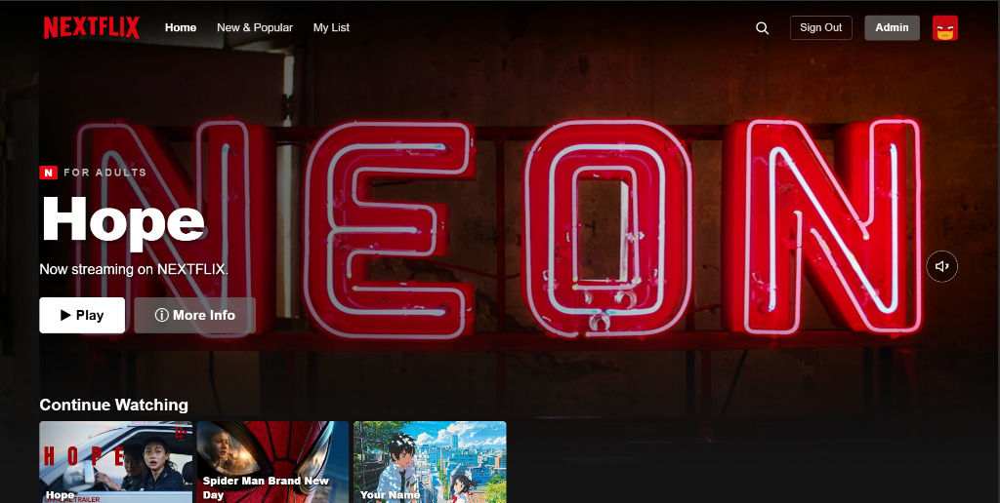
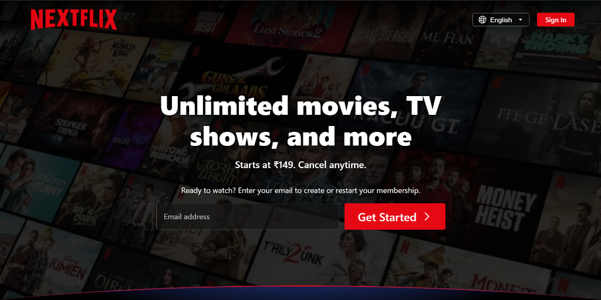
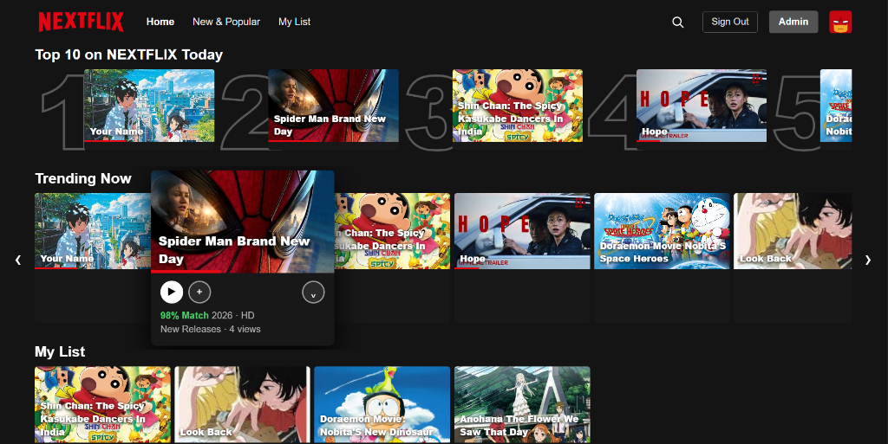
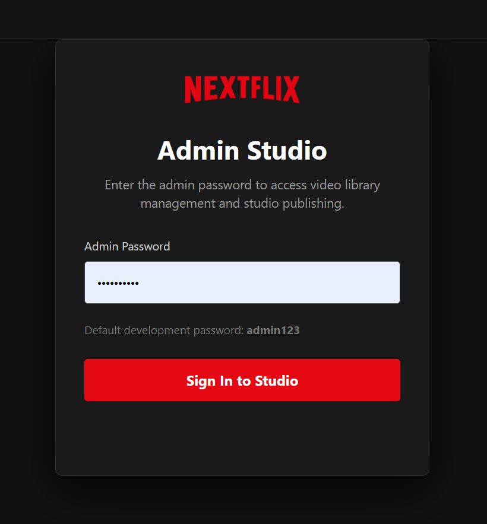

# 🎬 NEXTFLIX — Full-Stack Streaming Platform & Netflix Clone

[](https://nodejs.org)
[](https://expressjs.com)
[](https://www.sqlite.org)
[](LICENSE)
[](https://render.com)
[](https://nextflix-5vkx.onrender.com)

> **NEXTFLIX** is a full-stack video streaming application and high-fidelity Netflix recreation built with Vanilla JavaScript, Node.js, Express, and SQLite. Featuring HTTP Range streaming (HTTP 206), dynamic card hover previews, profile-scoped "Continue Watching" progress tracking, multi-profile switching with custom vector avatars & PIN protection, and an integrated Content Management Admin Studio.

---

<p align="center">
  
</p>

---

## 📑 Table of Contents

- [📸 Visual Showcase](#-visual-showcase)
- [🌟 Key Features](#-key-features)
- [🏗️ Architecture & Project Structure](#️-architecture--project-structure)
- [🚀 Quick Start (Local Setup)](#-quick-start-local-setup)
- [☁️ Deployment Guide: Render](#️-deployment-guide-render)
- [🔌 API Endpoints](#-api-endpoints)
- [🛠️ Tech Stack](#️-tech-stack)
- [👤 Author & License](#-author--license)

---

## 📸 Visual Showcase

### 1. Cinematic Landing & Onboarding
The landing experience replicates Netflix's responsive layout with an autoplaying background video, floating label email capture, Hindi/English language toggle, and collapsible FAQ accordion.

<p align="center">
  
</p>

---

### 2. Streaming Platform & "Continue Watching" Row
Authenticated users enter the browsing experience with spotlight hero video banner, dynamic category rails, card hover previews, and **per-profile Continue Watching progress bars** with timestamp resume.

<p align="center">
  
</p>

---

### 3. Top 10 Today, My List & Card Hover Previews
Stylized Top 10 ranked tiles with authentic Netflix numbered typography, personalized **My List** bookmark row, and an interactive **Card Hover Preview** that plays muted video snippets with quick action buttons upon hover.

<p align="center">
  
</p>

---

### 4. Admin Studio & Video Management
Protected studio portal with crypto-salted password security (`admin123`), enabling library curation, video file / YouTube URL ingestion, automated poster generation, and banner spotlight control.

<p align="center">
  
</p>

---

## 🌟 Key Features

### 🍿 Authentic Netflix Onboarding & Landing Experience
- **Cinematic Video Hero**: Autoplay hero video backdrop with dark radial and linear vignette gradients.
- **Interactive Onboarding**: One-click email capture with floating input labels, redirecting users directly into the registration flow.
- **FAQ Accordion & Language Picker**: Interactive expand/collapse questions and bilingual localization (English / हिन्दी).
- **Authentication Gateway**: Persistent sign-in / sign-up state with profile assignment.

### 👤 "Who's watching?" Multi-Profile System
- **Character Art Avatars**: High-resolution vector character avatars (Red Hero, Green Alien, Ronnie Monster Kid, Blue Smiley, Purple Chill) and anime covers.
- **Interactive "Manage Profiles" Mode**: Dedicated edit pencil overlays `✎` and prominent `[ DONE ]` controls.
- **Profile Customization & Protection**:
  - Custom name editing.
  - Avatar gallery picker with custom file upload support.
  - Maturity audience filtering (*For Adults*, *For Teens*, *For Kids*).
  - 4-digit PIN lock for private profile access.
- **History & URL Synchronization**: Smooth browser back-navigation support (`popstate`) ensuring modal transitions never unexpectedly close the page.

### 🎥 High-Performance Streaming & Progress Tracking
- **Profile-Scoped "Continue Watching"**:
  - Progress is uniquely isolated per user account/email and profile ID (`nx:user:profile:prog`).
  - Real-time watch tracking for both native video files and official YouTube streaming titles.
  - Red progress bar rendered on card thumbnails (`<i style="width:XX%"></i>`).
  - **Resume at Timestamp**: Automatically resumes video playback at the exact second where you left off (`&start=SS`).
  - One-click **"× Remove"** button to dismiss items from Continue Watching.
- **Interactive Card Hover Preview**:
  - Hovering on any title card launches an instant, muted video preview.
  - Non-blocking pointer interaction allows immediate clicking of *Play*, *Add to My List*, or *More Info*.
- **HTTP 206 Partial Content Streaming**:
  - Efficient byte-range video streaming for `.mp4`, `.mkv`, and `.webm` files.
- **Feature-Rich Video Player Modal**:
  - Playback speed selection (0.5x, 0.75x, 1x, 1.25x, 1.5x, 2x).
  - 15-second skip forward & rewind controls.
  - Direct "Watch on YouTube" shortcut for official full-length releases.

### 🛠️ Content Management & Admin Studio
- **Curated Video Library**: Pre-seeded with official blockbuster movies and complete full-season anime playlists (*KGF: Chapter 1*, *Bhool Bhulaiyaa*, *Attack on Titan*, *Tokyo Revengers*, *SPY x FAMILY*, *One-Punch Man*, *Mob Psycho 100*).
- **Metadata Editor**: Real-time updates for titles, descriptions, categories, release years, maturity ratings, and spotlight flags.
- **Secure Authentication**: Crypto-salted `scrypt` password hashing with environment fallback support (`ADMIN_PASSWORD`).

---

## 🏗️ Architecture & Project Structure

NEXTFLIX uses a clean, unified full-stack architecture with no unnecessary subfolder fragmentation:

```text
nextflix/
├── public/                  # Client-side web application assets
│   ├── index.html           # Landing page with video background & onboarding
│   ├── signup.html          # Authentication / Sign Up / Sign In
│   ├── browse.html          # Streaming catalog, video player & profile manager
│   ├── admin.html           # Full-featured Content Management Admin Studio
│   ├── admin-settings.html  # Admin security credentials settings
│   ├── app.js               # Streaming catalog, player controls & profile logic
│   ├── script.js            # Landing page interactivity & FAQ accordion
│   ├── streamflix.css       # Main streaming UI & profile styling
│   ├── styles.css           # Landing page styles & responsive layout
│   └── images/              # Visual assets, avatars & movie artwork
│       └── avatars/         # Vector character avatars (SVG)
├── screenshots/             # High-resolution README showcase screenshots
│   ├── landing-page.png     # Landing hero showcase
│   ├── browse-dashboard.png # Browse catalog & Continue Watching showcase
│   ├── catalog-hover.png    # Top 10 badges, My List & card hover preview
│   └── admin-studio.png     # Admin Studio portal showcase
├── uploads/                 # Media storage directory & uploaded posters
├── nextflix.db              # SQLite database (catalog, profiles, settings)
├── seed.js                  # Automated database migration and initial seed data
├── server.js                # Express streaming backend & REST API
├── package.json             # Root dependencies & npm scripts
├── render.yaml              # Render 1-click deployment Blueprint
└── .gitignore               # Ignores large video binaries (>100MB) & node_modules
```

---

## 🚀 Quick Start (Local Setup)

### Prerequisites
- [Node.js](https://nodejs.org) (v18.0.0 or higher recommended)
- [npm](https://www.npmjs.com/) or [pnpm](https://pnpm.io/)

### 1. Clone the repository
```bash
git clone https://github.com/alokroushan/nextflix.git
cd nextflix
```

### 2. Install dependencies
```bash
npm install
```

### 3. Start the application
```bash
npm start
```

### 4. Open in browser
Visit **`http://localhost:3000`** in your browser:
- **Landing Page**: `http://localhost:3000/`
- **Streaming Platform**: `http://localhost:3000/browse`
- **Admin Studio**: `http://localhost:3000/admin` *(Default password: `admin123`)*

---

## ☁️ Deployment Guide: Render

Render provides out-of-the-box support for persistent Node.js Web Services, SQLite database persistence, and HTTP Range streaming:

1. Create a free account at [render.com](https://render.com).
2. Click **New +** > **Web Service**.
3. Connect your GitHub repository: `https://github.com/alokroushan/nextflix`.
4. Configure the service:
   - **Environment**: `Node`
   - **Build Command**: `npm install`
   - **Start Command**: `node server.js`
   - **Plan**: `Free`
5. Click **Create Web Service**. Your streaming platform will be live in minutes!

*(Alternatively, use the included [`render.yaml`](render.yaml) for automated Blueprint deployment).*

---

## 🔌 API Endpoints

| Method | Endpoint | Description | Auth Required |
|---|---|---|---|
| `GET` | `/api/videos` | Fetch videos filtered by audience (`kids`, `teens`, `adults`) and search query | No |
| `POST` | `/api/videos/:id/view` | Increment view counter for a title | No |
| `POST` | `/api/login` | Authenticate admin studio | No |
| `GET` | `/api/session` | Validate admin authentication token | Yes |
| `POST` | `/api/videos` | Upload new video with custom poster and metadata | Yes |
| `PUT` | `/api/videos/:id` | Update metadata, banner feature flag, or age rating | Yes |
| `DELETE` | `/api/videos/:id` | Permanently remove a video and associated poster | Yes |
| `POST` | `/api/import-folder` | Bulk scan and ingest files from server filesystem | Yes |

---

## 🛠️ Tech Stack

- **Frontend**: HTML5, Modern CSS3 (CSS Grid, Flexbox, Custom Properties), Vanilla ES6+ JavaScript.
- **Backend**: Node.js, Express.js.
- **Database**: SQLite3 via `better-sqlite3`.
- **Media Processing**: Multer, HTTP 206 Partial Content Range streaming.
- **Security**: Node.js `crypto` with `scrypt` salt-hashing for admin authentication.
- **Deployment**: Render Web Service.

---

## 👤 Author & License

**Alok Roushan**
- GitHub: [@alokroushan](https://github.com/alokroushan)
- Repository: [https://github.com/alokroushan/nextflix](https://github.com/alokroushan/nextflix)
- Live Deployment: [https://nextflix-5vkx.onrender.com](https://nextflix-5vkx.onrender.com)

This project is open-source and available under the [MIT License](LICENSE).
